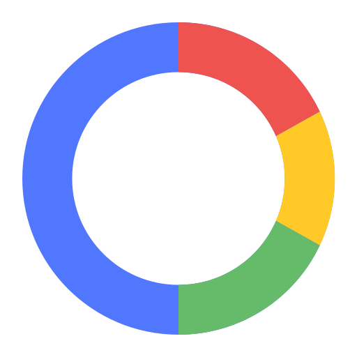

<div align="center">



# CircleToSearch

[](https://developer.android.com)
[](https://kotlinlang.org)
[](https://developer.android.com/jetpack/compose)
[](LICENSE)
[](#privacy-and-image-handling)

<p align="center">
  A native Kotlin app for Android 11 and newer. Tap the floating ball, draw around an item, and share its cropped image with Google Lens.
</p>

</div>

## Architecture & Components


## Build and setup

```powershell
.\gradlew.bat :app:assembleDebug
```

Install the APK from `app/build/outputs/apk/debug/app-debug.apk`. On first launch, use **Open accessibility settings** and enable CircleToSearch. Android requires the accessibility service for its screenshot API and accessibility overlay; the service declares screenshot capture only and does not request screen text or window content.

The settings screen stores ball size, visibility, and relative position in Preferences DataStore. The size slider updates the preview as you drag. Expanded windows use a centered two-pane layout; narrower windows use one column.

## Privacy and image handling

- No internet permission, analytics, or crash reporting.
- The full screenshot stays in memory. Drawing selects a padded rectangular crop from the stroke bounds.
- Only that crop is written to `cacheDir/lens/` for the FileProvider handoff. It is deleted after 60 seconds, when the screen turns off, and when the service starts or stops.
- The FileProvider is not exported and exposes only `cacheDir/lens/`. No MediaStore or gallery access is used.
- A blank screenshot, including the usual result from a `FLAG_SECURE` screen, is discarded with a toast.

## Dependencies

The app uses AndroidX only: Jetpack Compose Material 3 and window size classes for settings, Activity Compose, Lifecycle ViewModel, Preferences DataStore, and Core KTX for FileProvider. These provide the requested UI, settings persistence, lifecycle integration, and scoped URI sharing; there are no third-party runtime SDKs.

## Known limits

- Google has no public Lens API for this flow. The app sends `ACTION_SEND` with the crop to the Google app when available, otherwise opens the Android chooser. Google app versions may show a share or image screen instead of opening Lens directly.
- `FLAG_SECURE` screenshots cannot be searched. Detection treats an all-black capture as blocked, so a genuinely all-black screen is also rejected.
- Screenshot capture targets the default display. Rotation and display resizing cancel an active selection and clamp the ball back into bounds.
- Debug and release builds pass. On an Android 15 Pixel Tablet emulator, the `ACTION_SEND` handoff opened Google Lens, and turning the screen off removed the cached crop. A physical device was not available for testing.
